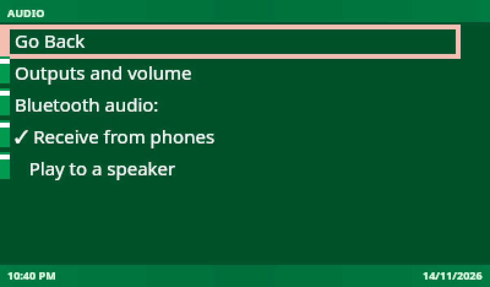
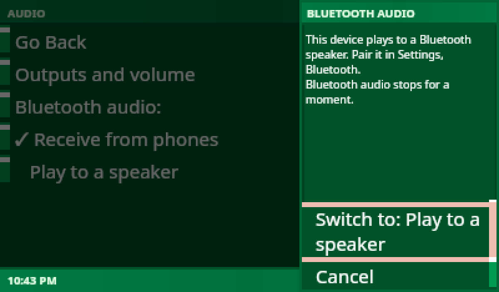
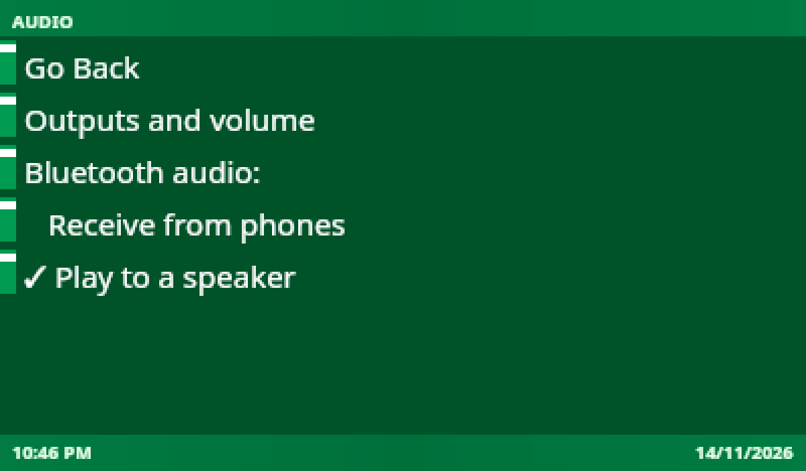
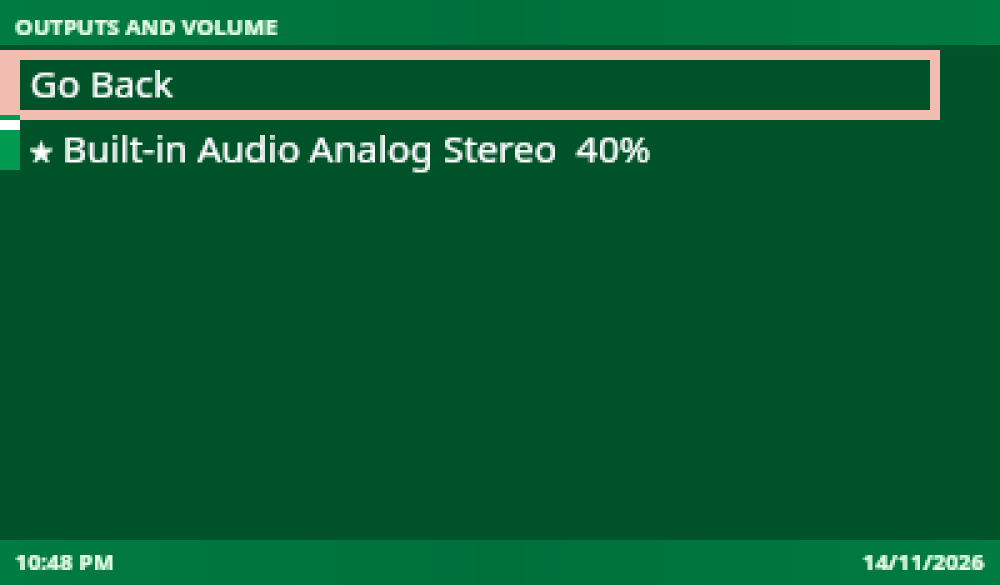
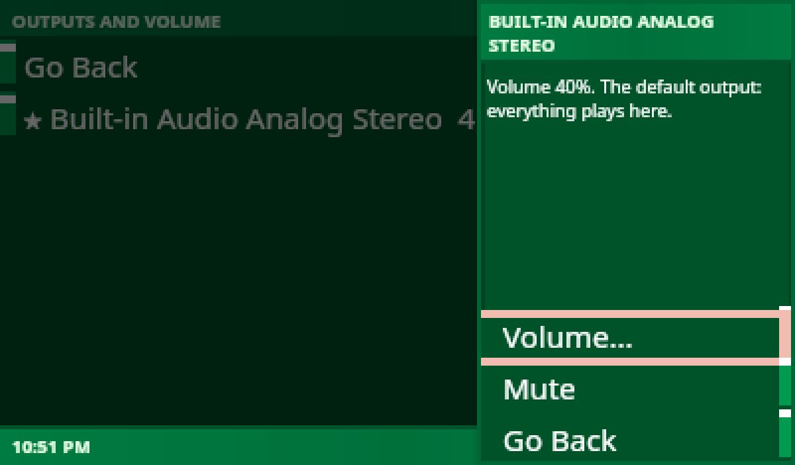
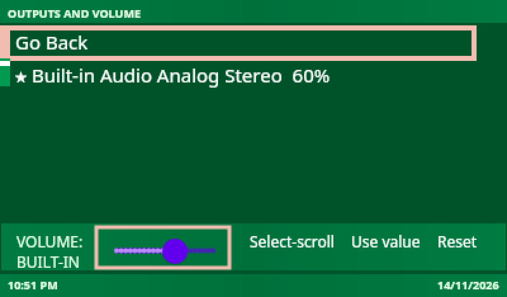

# Settings -> Audio

Screenshots from qemuarm64 (400x234, shown 3x).

| Settings -> Audio | Switching the Bluetooth role | After switching |
| --- | --- | --- |
|  |  |  |

| Outputs and volume | An output | The volume on the knob |
| --- | --- | --- |
|  |  |  |

- **Outputs and volume**: every audio output (PipeWire sink: the Pi's audio
  out, a Bluetooth speaker), from `pw-dump`; volume, mute and the default
  output through `wpctl`. The default output is starred.
- **Bluetooth audio**: *Receive from phones* (sink, the E39) or *Play to a
  speaker* (source). The HMI writes WirePlumber's `bluez5.roles` and restarts
  WirePlumber, which registers just those roles with BlueZ.
- Only where the image sets `E39_HMI_MANAGES_AUDIO=1` (e39-rpi-yocto); on a
  laptop the screen says so and changes nothing.
