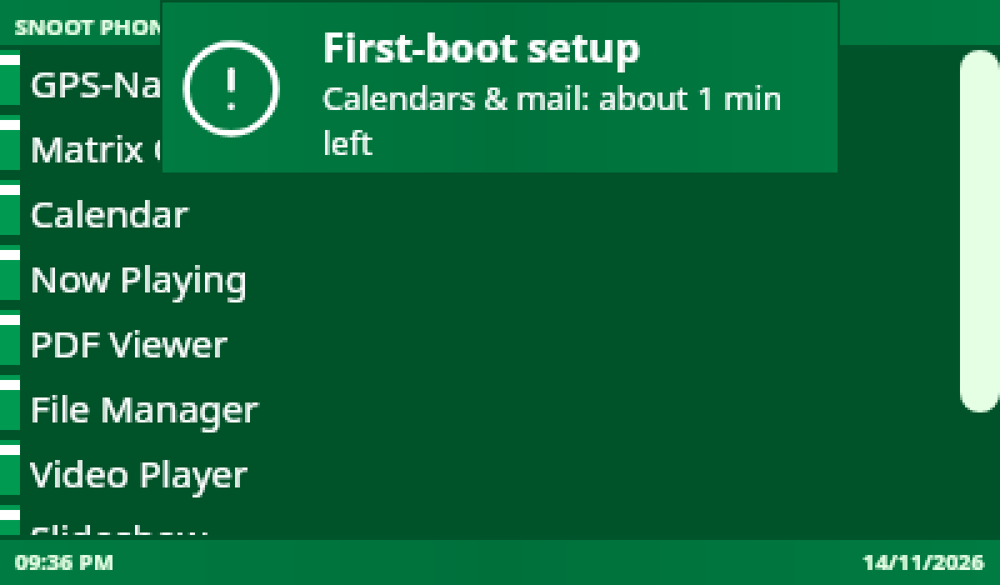
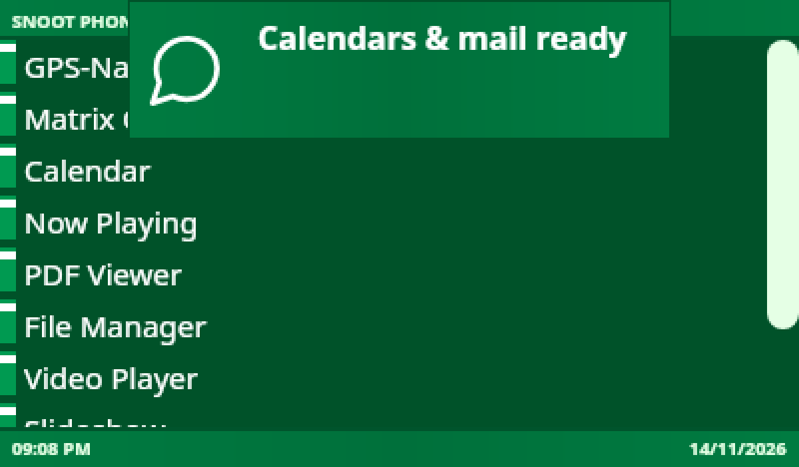

# First-boot notifications

`FirstBootNotifierService` (service group `Pim`) shows the progress of slow
first-boot tasks that the device reports in `/run/e39rpi-firstboot/*.status`
(e39-rpi-yocto, meta-e39rpi-pim: loading the PIM bridge's container image,
11-13 min in qemuarm64). Screenshots from qemuarm64 (400x234, shown 3x):

| While loading (reminders every 5 min) | Near the end | Done |
| --- | --- | --- |
|  |  |  |

The first two are from a real first boot; "ready" (shown for 3 s) is from a
status file written by hand, through the same code path.
